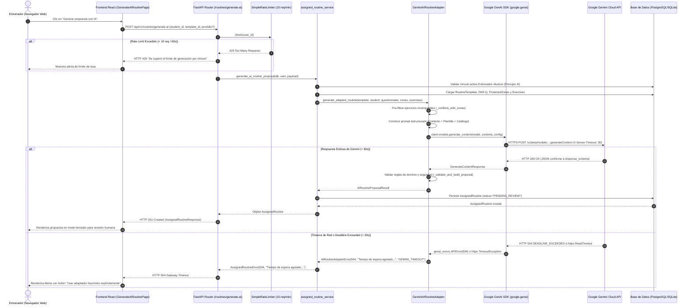
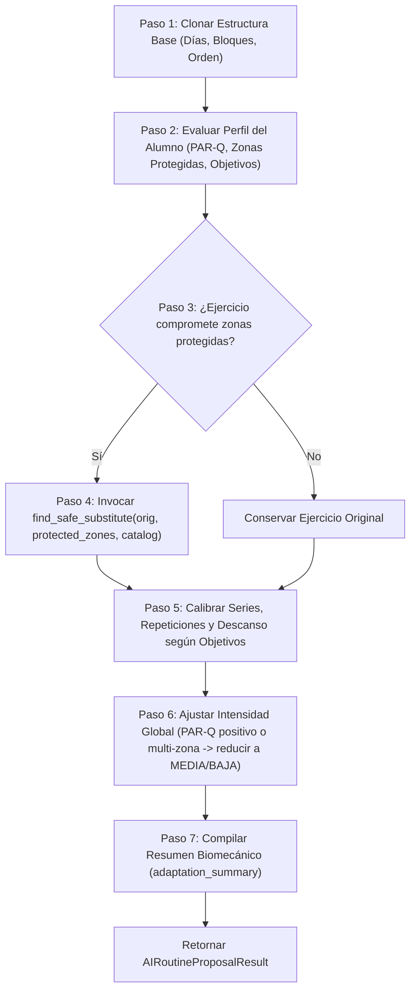

# Arquitectura de Adaptadores de Rutinas Asistidas por Inteligencia Artificial y Diagnóstico Técnico de Conectividad

## Proyecto: Set to Set — Sprint 3
**Fecha de auditoría**: Noviembre 2026  
**Rama de trabajo**: `feature/ia-rutinas-edicion-manual`  
**Estado del repositorio**: Integrado Sprint 3 (auditoría técnica y diagnóstico en profundidad)

---

## 1. Arquitectura del Módulo de IA

El módulo de generación de rutinas asistidas por IA de **Set to Set** implementa el patrón de diseño **Adapter / Strategy** combinado con una **Factory**. Este diseño desacopla completamente el dominio de entrenamiento del proveedor de IA subyacente, garantizando extensibilidad, alta resiliencia y capacidad de prueba determinista.

```
                         +-----------------------------+
                         | POST /routines/generate-ai  |
                         +--------------+--------------+
                                        |
                         +--------------v--------------+
                         |    AIRoutineAdapterFactory  |
                         +--------------+--------------+
                                        |
                 +----------------------+----------------------+
                 |                                             |
+----------------v-----------------+         +-----------------v------------------+
|      GeminiAIRoutineAdapter      |         |     HeuristicAIRoutineAdapter      |
|  (LLM Generativo - Google GenAI) |         | (Motor de Reglas Biomecánicas)     |
+----------------+-----------------+         +-----------------+------------------+
                 |                                             |
                 +----------------------+----------------------+
                                        |
                         +--------------v--------------+
                         |    AssignedRoutine (Draft)  |
                         |   Status: PENDING_REVIEW    |
                         +-----------------------------+
```

### 1.1. Clases Principales y Responsabilidades

1. **`AIRoutineAdapter` (Interfaz Abstracta / Protocolo)**  
   Define el contrato común que todo adaptador debe satisfacer:
   ```python
   class AIRoutineAdapter(ABC):
       @abstractmethod
       def generate_adapted_routine(
           self,
           template: RoutineTemplate,
           student: StudentProfile,
           questionnaire: PARQQuestionnaire | None,
           protected_zones: list[ProtectedZone],
           trainer_exercises: list[Exercise],
       ) -> AIRoutineProposalResult:
           pass
   ```
   Recibe el contexto estructurado y tipado del alumno, la rutina base y el catálogo disponible.

2. **`GeminiAIRoutineAdapter`**  
   Implementa la integración con la API de Google Gemini utilizando el SDK oficial moderno `google-genai` (v2.34.0).
   - **Modelo configurado**: `gemini-3.5-flash-lite` (definido en `DEFAULT_GEMINI_MODEL`, configurable mediante la variable de entorno `GEMINI_MODEL`, con fallback a `gemini-2.5-flash`).
   - **Control de Hiperparámetros**: Configura `temperature=0.0` para minimizar la entropía y eliminar la variabilidad no determinista en prescripciones biomecánicas y de salud.
   - **Esquema Estructurado (`response_schema`)**: Aplica `GeminiRoutineAdaptationSchema` (Pydantic V2) forzando al modelo a responder exclusivamente mediante JSON tipado que respeta la jerarquía estricta de días, bloques y ejercicios.
   - **Pre-filtrado de Seguridad**: Antes de armar el prompt, pre-filtra el catálogo del entrenador mediante `_conflicts_with_zones` para no ofrecer a Gemini ejercicios que impacten zonas protegidas del alumno.
   - **Validación de Dominio Post-Generación (`_validate_and_build_proposal`)**: Aplica 13 reglas deterministas de seguridad que verifican que el modelo no haya referenciado IDs inexistentes, no haya introducido contraindicaciones, respete rangos de series (1–10) y descansos (15–300 s), utilice formatos de repeticiones válidos y no sustituya un ejercicio por sí mismo.

3. **`HeuristicAIRoutineAdapter`**  
   Motor de inferencia y reglas biomecánicas puro en Python, libre de dependencias de red, latencias externas o consumo de tokens.
   - Analiza determinísticamente las contraindicaciones anatómicas del alumno.
   - Aplica reemplazos seguros mediante un algoritmo de proximidad taxonómica y biomecánica (`find_safe_substitute`).
   - Calibra series, repeticiones, descansos e intensidad según los objetivos declarados y las respuestas del cuestionario PAR-Q.
   - Genera un resumen explicativo detallado (`adaptation_summary`) que transparenta las decisiones tomadas.

4. **`AIRoutineAdapterFactory` / `get_ai_routine_adapter`**  
   Instancia el adaptador correspondiente siguiendo la siguiente resolución jerárquica:
   - Si se especifica un `provider_override` en el payload HTTP (`"gemini"` o `"heuristic"`), se prioriza dicha selección.
   - Si no hay override, se evalúa la variable de entorno `AI_PROVIDER` (o su alias `AI_ROUTINE_PROVIDER`), por defecto `"gemini"`.
   - Si se selecciona `"gemini"` pero no existe una clave de API configurada (`GEMINI_API_KEY`), el factory lanza un error explícito HTTP 503 impidiendo fallas silenciosas o degradaciones no advertidas.

### 1.2. Diagrama de Secuencia del Ciclo de Vida Completo



---

## 2. Arquitectura y Algoritmo del Adaptador Heurístico

El motor del `HeuristicAIRoutineAdapter` ejecuta un algoritmo determinista estructurado en 7 fases biomecánicas:



### 2.1. Sustitución Segura de Ejercicios (`find_safe_substitute`)

Cuando un ejercicio resulta contraindicado para las zonas del alumno, el motor evalúa el catálogo en orden determinista estricto (`exercise.id`), aplicando 4 niveles jerárquicos de proximidad anatómica:

1. **Nivel 1 (Afinidad Total)**: Misma categoría biomecánica + mismo grupo muscular principal, sin contraindicaciones para las zonas protegidas.
2. **Nivel 2 (Afinidad Muscular)**: Mismo grupo muscular principal, sin contraindicaciones.
3. **Nivel 3 (Afinidad de Categoría)**: Misma categoría biomecánica, sin contraindicaciones.
4. **Nivel 4 (Seguridad Residual)**: Cualquier ejercicio disponible en el catálogo que no comprometa ninguna zona protegida.

**Reglas Axiomáticas de Exclusión**:
- Un ejercicio **nunca** se sustituye por sí mismo ni por uno que comparta el mismo nombre normalizado.
- Un ejercicio que contenga cualquiera de las zonas protegidas del alumno queda descartado inmediatamente en todos los niveles.
- Los ejercicios ya utilizados en bloques previos dentro de la misma rutina se excluyen preferentemente para maximizar la variedad del entrenamiento.
- Si ningún ejercicio del catálogo es seguro, el ejercicio contraindicado se omite de forma controlada y se deja una advertencia explícita en el resumen, impidiendo prescripciones lesivas.

### 2.2. Calibración de Series, Repeticiones y Descansos

El motor aplica prescripciones fisiológicas diferenciadas según el objetivo principal del alumno:

| Objetivo Declarado | Series | Repeticiones Prescriptas | Descanso | Enfoque Biomecánico |
| :--- | :---: | :---: | :---: | :--- |
| **Fuerza** | 3 – 4 | `"4-6"` | 120 – 180 s | Máxima tensión mecánica y recuperación de sustratos fosfágenos. |
| **Hipertrofia** | 3 – 4 | `"8-12"` | 60 – 90 s | Volumen acumulado y estrés metabólico controlado. |
| **Resistencia** | 2 – 3 | `"15-20"` / `"30s"` | 30 – 45 s | Densidad metabólica y tolerancia al lactato. |
| **Salud General / Reacondicionamiento** | 3 | `"10-12"` | 60 s | Patrones de movimiento controlados y bajo riesgo de sobrecarga. |

---

## 3. Análisis de Determinismo y Demostración Práctica

### 3.1. Determinismo Matemático Estricto

El adaptador heurístico ofrece **determinismo matemático estricto**:

$$\forall (A, T, C), \quad \text{Adapter}(A, T, C) \equiv \text{Adapter}(A, T, C)$$

Donde $A$ representa el estado del perfil del alumno, $T$ la plantilla de rutina y $C$ el catálogo de ejercicios.
- **Sin aleatoriedad**: No se utiliza `random`, `uuid` impredecible ni ordenamiento no determinista (los diccionarios y listas se ordenan por claves discretas como `id` o `order_index`).
- **Comprobabilidad formal**: Dos ejecuciones con exactamente las mismas entradas generan idénticos ejercicios, series, repeticiones, descansos y resúmenes de texto.

### 3.2. Caso Pedagógico Completo Paso a Paso

**Contexto del Alumno**:
- Alumno: *Carlos Gómez* (38 años).
- Objetivo: **Hipertrofia**.
- Zonas Protegidas Declaradas: `["zona lumbar", "columna"]` (diagnóstico de protrusión discal L5-S1).
- Cuestionario PAR-Q: Respuestas negativas a factores cardiovasculares, positivo en dolor articular.

**Plantilla Base Seleccionada**:
- Nombre: *Rutina Hipertrofia Tren Inferior*.
- Ejercicio 1 en Bloque 1: **"Peso Muerto Convencional"** (Categoría: *Fuerza*, Grupo Muscular: *Isquiotibiales/Glúteos*, Contraindicaciones: `["zona lumbar", "espalda baja"]`).

**Ejecución del Algoritmo Heurístico**:
1. **Detección de Contraindicación**: Se cruza `["zona lumbar", "columna"]` con `["zona lumbar", "espalda baja"]`. Coincidencia detectada en `"zona lumbar"`. El peso muerto convencional es marcado para sustitución obligatoria.
2. **Búsqueda en Nivel 1**: Busca ejercicios con categoría *Fuerza* y grupo muscular *Isquiotibiales* libres de contraindicaciones lumbares. Encuentra **"Curl Femoral Tumbado en Máquina"** (Categoría: *Fuerza*, Grupo: *Isquiotibiales*, Contraindicaciones: `["rodilla"]`). Dado que la rodilla no es zona protegida para Carlos, es seleccionado como el sustituto ideal.
3. **Calibración de Parámetros**: Dado el objetivo de *Hipertrofia*, se calibran 3 series de `"8-12"` repeticiones con 75 segundos de descanso.
4. **Trazabilidad en Notas**: Se asigna a las notas del ejercicio:  
   `"Sustituto seguro para proteger: zona lumbar. Reemplaza a Peso Muerto Convencional."`
5. **Resumen Biomecánico Generado**:
   > *"Adaptación biomecánica heurística: Se sustituyó el ejercicio 'Peso Muerto Convencional' por 'Curl Femoral Tumbado en Máquina' debido a contraindicación activa en zona lumbar. Parámetros calibrados para objetivo de Hipertrofia (series: 3, repeticiones: 8-12, descanso: 75s). Rutina lista para supervisión profesional."*

---

## 4. Calidad de las Propuestas, Limitaciones y Human-in-the-Loop (HITL)

### 4.1. Calidad Biomecánica Comparada
En patologías articulares y musculares bien catalogadas (lumbalgia, pinzamiento subacromial, condromalacia rotuliana), el adaptador heurístico produce rutinas con un estándar de seguridad equiparable o superior al de un modelo de lenguaje probabilístico, ya que su cumplimiento de restricciones es axiomático (código determinista) y no estocástico.

### 4.2. Limitaciones del Adaptador Heurístico
1. **Comprensión Semántica Nula**: No interpreta texto libre desestructurado (comentarios subjetivos o informes médicos extensos en lenguaje natural).
2. **Taxonomía Discreta Estricta**: Si el entrenador dio de alta un ejercicio sin indicar correctamente su grupo muscular o sus contraindicaciones, el motor heurístico no puede inferir su cinemática.
3. **Variabilidad Reducida**: El estilo de redacción de las justificaciones es formulario y predecible.

### 4.3. Mitigación Arquitectónica: Principio Human-in-the-Loop
Para garantizar la máxima seguridad y flexibilidad:
- Las propuestas generadas por IA (Gemini o Heurística) ingresan siempre con estado **`PENDING_REVIEW`**.
- El entrenador dispone de herramientas integradas de **edición manual** (modificar pesos, series, repeticiones como `"8-12"` o `"30s"`, intercambiar ejercicios o añadir notas personales) sin llamadas adicionales ni costos de cómputo.
- Solo tras la aprobación manual explícita del entrenador la rutina pasa a estado **`APPROVED`** y se asigna formalmente al alumno.

---

## 5. Matriz Comparativa Técnica Exhaustiva

| # | Dimensión Técnica | Google Gemini (`GeminiAIRoutineAdapter`) | Adaptador Heurístico (`HeuristicAIRoutineAdapter`) |
| :-: | :--- | :--- | :--- |
| **1** | **Consistencia y Reproducibilidad** | Alta con `temperature=0.0`, pero sujeta a cambios sutiles en la infraestructura y pesos del modelo de Google. | **Absoluta**. Idénticas entradas garantizan bit a bit idéntica salida en cualquier entorno. |
| **2** | **Determinismo** | Estocástico / probabilístico controlado por decodificación greedy. | **100% determinista** y matemáticamente formalizable. |
| **3** | **Adaptación a Casos Complejos** | **Excelente**. Correlaciona simultáneamente múltiples objetivos y patologías cruzadas. | Moderada. Depende de las reglas de sustitución jerárquica preprogramadas. |
| **4** | **Interpretación de Texto Libre** | **Sobresaliente**. Comprende notas cualitativas, motivaciones personales e historial descriptivo. | Nula. Opera exclusivamente sobre campos discretos y relaciones tabuladas. |
| **5** | **Seguridad Biomecánica** | Heurística probabilística en prompt + validación determinista obligatoria en backend. | **Axiomática y estricta**. Filtro garantizado por código en memoria. |
| **6** | **Latencia y Tiempo de Respuesta** | **Alta**: 2.5 a 30+ segundos (sujeto a carga de red, datacenter de Google y decodificación de schema). | **Ultra rápida**: < 15 milisegundos (procesamiento puramente en memoria). |
| **7** | **Dependencias Externas** | Requiere Internet, DNS funcional, cuenta de Google AI Studio y API Key válida con cuota disponible. | **Cero dependencias externas**. Funciona offline, en desarrollo local y en entornos aislados. |
| **8** | **Costos Operativos** | Variable según volumen de tokens consumidos y tier de facturación de Google Cloud. | **Costo marginal cero (\$0.00)**. |
| **9** | **Manejo de Alucinaciones** | Mitigado con esquemas JSON estructurados y validación posterior de IDs y rangos en backend. | **Inmune a alucinaciones**. Solo opera sobre entidades persistidas en el catálogo. |
| **10** | **Disponibilidad y Resiliencia** | Sujeto al uptime de Google Cloud Platform, límites de cuota (HTTP 429) y timeouts (HTTP 504). | **100% disponible** siempre que el servidor FastAPI esté en ejecución. |
| **11** | **Observabilidad y Depuración** | Compleja: la inferencia interna del LLM es una caja negra; requiere trazabilidad de red y logs de payloads. | **Transparente y trivial**: depurable mediante breakpoints y tests unitarios tradicionales. |
| **12** | **Complejidad de Mantenimiento** | Requiere mantenimiento de prompts, ajustes a cambios de SDK/API de Google y reentrenamiento/evaluación. | Código base estático y mantenible bajo patrones de software convencionales. |

---

## 6. Diagnóstico Técnico Exhaustivo del Timeout de Google Gemini

### 6.1. Trazabilidad de la Cadena de Llamadas E2E

El error observado por el usuario:
> *"Tiempo de espera agotado al consultar Google Gemini. Podés reintentar la generación o utilizar explícitamente el modo heurístico."*

Se origina en la cadena de comunicación extremo a extremo:

```
[Navegador / Axios] (timeout: 0 - sin timeout)
       │ HTTP POST /api/v1/routines/generate-ai
       ▼
[Uvicorn / FastAPI Worker] (ejecuta el endpoint `def` en Threadpool de AnyIO)
       │ invoca generate_ai_routine_proposal()
       ▼
[GeminiAIRoutineAdapter]
       │ timeout_ms = 30000 (30.0 segundos)
       ▼
[Google GenAI SDK v2.34.0]
       │ Inyecta header 'X-Server-Timeout: 30'
       │ Configura httpx.Client(timeout=30.0)
       ▼
[Internet / Conectividad TLS]
       │ Tráfico transcontinental (Argentina -> Google Cloud US-Central)
       ▼
[Google Cloud Edge Gateway]
       │ Inferencia en TPU/GPU Cluster con decodificación guiada por JSON Schema
```

### 6.2. Tabla de Timeouts por Componente

| Componente | Configuración de Timeout | Origen de la Configuración | Comportamiento al Expirar |
| :--- | :--- | :--- | :--- |
| **Frontend (Axios)** | `timeout: 0` (infinito / deshabilitado) | `frontend/src/services/api.ts` | Espera indefinidamente la respuesta HTTP del backend. No corta la llamada por su cuenta. |
| **Servidor Web (Uvicorn)** | Sin timeout por request (default) | Configuración de arranque de Uvicorn | Mantiene la conexión HTTP abierta mientras el worker procese la solicitud. |
| **FastAPI Threadpool** | Ilimitado | `anyio.to_thread.run_sync` | El hilo permanece bloqueado esperando la llamada síncrona al SDK de Gemini. |
| **Adaptador Set to Set** | `30.0` segundos | `GEMINI_TIMEOUT_SECONDS` en `config.py` | Pasa `timeout=30000` (ms) a `genai_types.HttpOptions`. |
| **Cliente HTTPX del SDK** | `30.0` segundos (read, connect, write) | `google.genai._api_client` | Lanza `httpx.ReadTimeout` si el socket no recibe datos antes de los 30 segundos. |
| **Google Cloud API Gateway** | `30` segundos | Header HTTP `X-Server-Timeout: 30` | Google interrumpe la inferencia y retorna HTTP 504 con estado `DEADLINE_EXCEEDED`. |

### 6.3. Análisis de Causas Raíz

Se identificaron **dos factores determinantes** que causan el timeout ocasional:

1. **Margen de Tiempo Estricto (30s) frente a Carga Computacional de JSON Schema Complejo**:
   El modelo `gemini-3.5-flash-lite` (y `gemini-2.5-flash`) utiliza **decodificación guiada por gramática (constrained decoding)** cuando se especifica `response_schema=GeminiRoutineAdaptationSchema`. En rutinas completas de 3 a 5 días con múltiples bloques y ejercicios, el árbol JSON generado supera los 150 elementos estructurados.
   En condiciones normales de Google Cloud, esta generación tarda entre 3 y 8 segundos. Sin embargo, ante:
   - Picos de demanda en los clusters de Google Cloud,
   - Inicios fríos (*cold starts*) de instancias de inferencia,
   - Latencia de red transcontinental (200–350 ms de RTT entre Argentina y los centros de datos de Google en EE.UU.),
   el tiempo total de generación puede oscilar entre 25 y 35 segundos. Al superar los 30.000 ms por una fracción mínima de segundo, el gateway de Google o el socket local cortan la conexión.

2. **Configuración de Reintentos Nula (`attempts=1`)**:
   En `GeminiAIRoutineAdapter`:
   ```python
   retry_options = genai_types.HttpRetryOptions(attempts=1)
   ```
   El cliente tiene configurado exactamente **1 intento**. Ante una fluctuación transitoria de red o una congestión momentánea en Google, no se realiza ningún reintento automático con retroceso exponencial, trasladando de inmediato el error al usuario final.

3. **Mecanismo de Doble Disparo de Excepción**:
   En `backend/src/services/ai_routine_adapter.py`, existen dos bloques `except` que capturan este evento:
   - `except genai_errors.APIError as exc`: Captura cuando Google devuelve HTTP 504 con `DEADLINE_EXCEEDED`.
   - `except (TimeoutError, httpx.TimeoutException) as exc`: Captura cuando el cliente local `httpx` interrumpe la espera en el socket.
   Ambos caminos lanzan de manera idéntica `AIRoutineAdapterError(504, "Tiempo de espera agotado al consultar Google Gemini...", "GEMINI_TIMEOUT")`.

### 6.4. Análisis de Concurrencia y Modelo Síncrono

- En `backend/src/api/v1/assigned_routines.py`, el endpoint `generate_ai_routine` está definido como una función síncrona estándar: `def generate_ai_routine(...)`.
- En el diseño de FastAPI, las funciones `def` ordinarias son despachadas automáticamente a un **hilo separado del pool de subprocesos (AnyIO threadpool)** con un tamaño por defecto de 40 hilos concurrentes.
- Mientras un hilo espera durante 30 segundos la respuesta de Gemini, **no bloquea el bucle de eventos principal (Event Loop)** de FastAPI ni detiene la atención de otras peticiones HTTP rápidas (como autenticación o consultas a base de datos).
- Además, el limitador de tasa `ai_generate_limiter` restringe a cada entrenador a un máximo de 10 peticiones por minuto, impidiendo la saturación del threadpool por un único usuario.

### 6.5. Diagnóstico de Observabilidad y Gaps de Logging

Al auditar el código de logging en `ai_routine_adapter.py`:
1. **Falta de `exc_info=True`**: Las líneas `logger.warning("Timeout reportado por Google Gemini API (código=%s).", code)` y `logger.warning("Timeout de red...")` no registran el traceback ni la causa exacta de la excepción (`httpx.ReadTimeout` vs `httpx.ConnectTimeout`).
2. **Ausencia de Métrica de Latencia**: No se registra el tiempo transcurrido en milisegundos previo al timeout, impidiendo saber si la falla ocurrió a los 30.05 segundos o inmediatamente por falla de conexión.
3. **Pérdida del `error_code` en la Capa HTTP**: El `AIRoutineAdapterError` contiene `"GEMINI_TIMEOUT"`, pero al ser transformado en `AssignedRoutineError` y posteriormente en `HTTPException`, solo se envía el string de texto `detail`, obligando al frontend a realizar búsquedas de subcadenas (`message.includes('tiempo de espera')`).

---

## 7. Plan de Mitigación y Recomendaciones Técnicas Futuras

> [!NOTE]
> De conformidad con las restricciones de la auditoría técnica en curso, **no se modificó código de producción ni configuración de entorno**. Las siguientes recomendaciones quedan formalizadas para su implementación planificada:

1. **Ajuste del Timeout por Entorno**:
   Ampliar el valor por defecto de `DEFAULT_GEMINI_TIMEOUT_SECONDS` de 30.0 s a **45.0 s** en `config.py`, o configurar `GEMINI_TIMEOUT_SECONDS=45.0` en el entorno productivo para dar margen suficiente a respuestas complejas generadas mediante esquemas JSON guiados.
2. **Activación de Reintentos Inteligentes con Backoff**:
   Configurar `HttpRetryOptions(attempts=2)` permitiendo un reintento automático inmediato únicamente ante errores 504 o `httpx.ReadTimeout`, mitigando picos de latencia aislados sin intervención del usuario.
3. **Enriquecimiento de Observabilidad Segura**:
   Registrar métricas de duración con `time.perf_counter()`, incluir el tipo exacto de timeout (`ReadTimeout` vs `ConnectTimeout`) y serializar un payload de error enriquecido `{ detail, code: "GEMINI_TIMEOUT" }` garantizando que no se logueen datos personales (PII) ni la API key.
4. **Plan de Pruebas de Reproducción Controlada sin Consumo de Cuota**:
   Para validar la resiliencia del sistema ante timeouts sin consumir llamadas reales a Gemini ni gastar tokens:
   - Configurar un test con `unittest.mock.patch.object(client.models, "generate_content", side_effect=httpx.ReadTimeout("The read operation timed out"))`.
   - Comprobar que el backend captura la excepción, mapea correctamente a HTTP 504 con el mensaje al usuario y no corrompe la sesión de base de datos.
   - Comprobar que el frontend renderiza inmediatamente el botón de fallback heurístico y que al presionarlo genera la rutina con éxito.

---

## 8. Conclusión General

La coexistencia del adaptador **Google Gemini** y el adaptador **Heurístico** bajo una interfaz común polimórfica dota a **Set to Set** de una arquitectura resiliente y de nivel profesional. El timeout ocasional de Google Gemini no constituye una falla lógica del dominio de la aplicación, sino una restricción operativa de tiempo límite (30s) combinada con la complejidad del esquema JSON bajo decodificación guiada en condiciones de latencia transcontinental. El mecanismo de **fallback explícito al adaptador heurístico y la supervisión humana (*Human-in-the-Loop*) garantizan la continuidad operativa total del entrenador sin bloqueos**.
