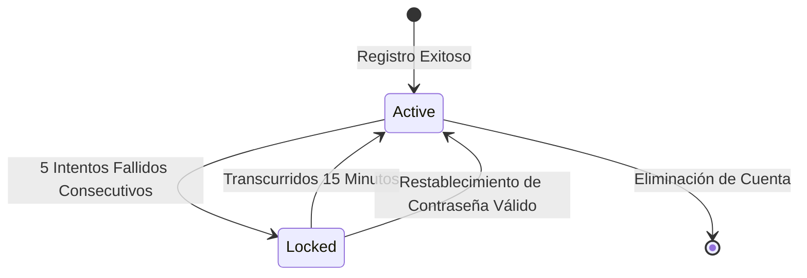

# Data Model: Autenticación, Gestión de Cuentas y Recuperación

**Feature**: `001-auth-and-accounts`
**Date**: 2026-10-15

## Entidades y Atributos

### 1. `User`
Representa la cuenta de acceso de cualquier persona registrada en la plataforma (entrenador o alumno).

| Campo | Tipo | Nulo | Por Defecto | Descripción |
|---|---|---|---|---|
| `id` | UUID / String(36) | No | `uuid4()` | Identificador único primario. |
| `email` | String(255) | No | - | Correo electrónico único normalizado (minúsculas, trim). Índice único. |
| `password_hash` | String(255) | No | - | Hash criptográfico de la contraseña (Argon2id / Bcrypt). |
| `role` | Enum(`TRAINER`, `STUDENT`) | No | - | Rol del usuario en el sistema. Determina navegación y permisos. |
| `is_active` | Boolean | No | `True` | Estado de activación de la cuenta. |
| `failed_login_attempts` | Integer | No | `0` | Contador de intentos fallidos consecutivos de login. |
| `locked_until` | DateTime (UTC) | Sí | `None` | Marca temporal hasta la cual la cuenta permanece bloqueada. |
| `created_at` | DateTime (UTC) | No | `utcnow()` | Fecha y hora de creación de la cuenta. |
| `updated_at` | DateTime (UTC) | No | `utcnow()` | Fecha y hora de última modificación. |

### 2. `UserSession`
Sesión emitida en cada inicio de sesión exitoso (US-75).

| Campo | Tipo | Nulo | Por Defecto | Descripción |
|---|---|---|---|---|
| `id` | UUID / String(36) | No | `uuid4()` | Identificador primario. |
| `user_id` | UUID / String(36) | No | - | Clave foránea referenciando a `User.id` con eliminación en cascada. |
| `jti` | String(36) | No | - | Identificador único del JWT emitido. Restricción de unicidad. |
| `expires_at` | DateTime (UTC) | No | - | Fecha de expiración de la sesión. |
| `revoked_at` | DateTime (UTC) | Sí | `None` | Fecha de revocación por cierre de sesión o restablecimiento de contraseña. |

### 3. `PasswordResetToken`
Tokens emitidos para el restablecimiento de contraseñas olvidadas (US-76).

| Campo | Tipo | Nulo | Por Defecto | Descripción |
|---|---|---|---|---|
| `id` | UUID / String(36) | No | `uuid4()` | Identificador primario. |
| `user_id` | UUID / String(36) | No | - | Clave foránea referenciando a `User.id` con eliminación en cascada. |
| `token_hash` | String(64) | No | - | Hash SHA-256 del token plano generado en backend. |
| `expires_at` | DateTime (UTC) | No | - | Fecha de expiración (exactamente 1 hora tras emisión). |
| `used_at` | DateTime (UTC) | Sí | `None` | Fecha en que fue consumido para cambiar la contraseña, o invalidado al emitirse un token más reciente del mismo usuario. |
| `created_at` | DateTime (UTC) | No | `utcnow()` | Fecha de generación. |

## Reglas de Validación y Restricciones

1. **Email**: Debe tener formato RFC 5322 válido. Se convierte a minúsculas antes de persistir o validar.
2. **Contraseña**:
   - Longitud mínima: 8 caracteres.
   - Debe contener al menos una letra mayúscula (`[A-Z]`).
   - Debe contener al menos una letra minúscula (`[a-z]`).
   - Debe contener al menos un dígito numérico (`[0-9]`).
3. **Bloqueo por Fuerza Bruta**:
   - Cada intento fallido incrementa `failed_login_attempts` en 1.
   - Si `failed_login_attempts >= 5`: `locked_until = now() + 15 minutes`.
   - Si `locked_until > now()`: se deniega el acceso sin validar la contraseña.
   - Al pasar exitosamente la autenticación: `failed_login_attempts = 0` y `locked_until = None`.
   - Al completarse un restablecimiento de contraseña exitoso: `failed_login_attempts = 0` y `locked_until = None`.
4. **Tokens de Recuperación**: al emitir un token nuevo para un usuario, se marcan como invalidados (`used_at = now()`) todos sus tokens previos aún vigentes; solo el último emitido es utilizable. Un token es válido solo si existe, `used_at` es nulo, `expires_at > now()` y su usuario está activo.
5. **Restablecimiento exitoso**: actualiza `password_hash`, marca el token con `used_at = now()` y revoca (`revoked_at = now()`) todas las `UserSession` activas del usuario, en la misma transacción.

## Diagrama de Estados de Cuenta

