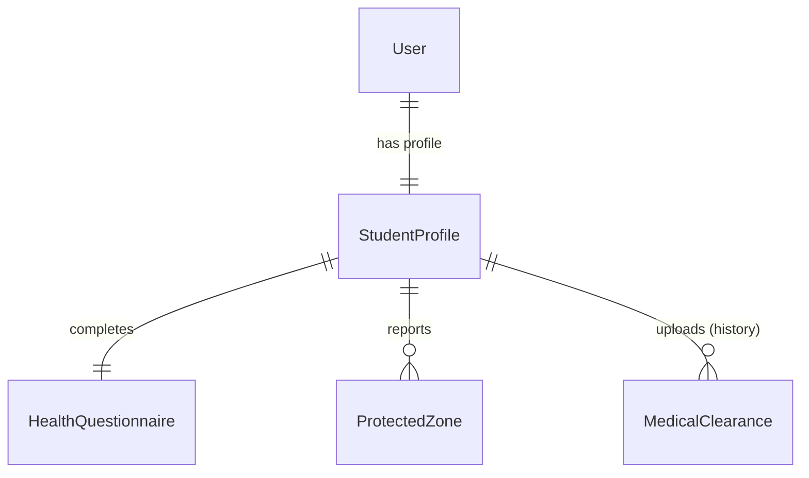

# Data Model: Perfil del Alumno, Cuestionario de Salud y Apto Médico

**Feature**: `003-student-profile-and-health`
**Date**: 2026-10-15

## Entidades y Atributos

### 1. `StudentProfile`
Datos personales y deportivos del alumno (US-39, US-40).

| Campo | Tipo | Nulo | Por Defecto | Descripción |
|---|---|---|---|---|
| `id` | UUID / String(36) | No | `uuid4()` | Identificador primario. |
| `user_id` | UUID / String(36) | No | - | Clave foránea 1:1 a `User.id`. Índice único. |
| `first_name` | String(100) | No | - | Nombre obligatorio. |
| `last_name` | String(100) | No | - | Apellido obligatorio. |
| `contact_phone` | String(50) | No | - | Teléfono de contacto obligatorio. |
| `birth_date` | Date | Sí | `None` | Fecha de nacimiento para cálculo de edad. |
| `fitness_goals` | JSON / Text | No | `'[]'` | Lista de objetivos seleccionados (ej. `["fuerza", "salud"]`). |
| `personal_motivation` | Text | Sí | `None` | Motivaciones expresadas en onboarding (US-40). |
| `created_at` | DateTime (UTC) | No | `utcnow()` | Fecha de alta. |
| `updated_at` | DateTime (UTC) | No | `utcnow()` | Fecha de modificación. |

### 2. `HealthQuestionnaire` (PAR-Q adaptado, US-41)
Cuestionario inicial clínico obligatorio antes de entrenar.

| Campo | Tipo | Nulo | Por Defecto | Descripción |
|---|---|---|---|---|
| `id` | UUID / String(36) | No | `uuid4()` | Identificador primario. |
| `student_id` | UUID / String(36) | No | - | Clave foránea 1:1 a `StudentProfile.id`. |
| `has_heart_condition` | Boolean | No | `False` | ¿Padece alguna afección cardíaca conocida? |
| `has_chest_pain_activity` | Boolean | No | `False` | ¿Siente dolor en el pecho al realizar actividad física? |
| `has_dizziness_or_balance_loss` | Boolean | No | `False` | ¿Sufre mareos o pérdidas de equilibrio? |
| `has_bone_joint_problem` | Boolean | No | `False` | ¿Tiene problemas articulares o en huesos que empeoran con el ejercicio? |
| `takes_prescription_meds` | Boolean | No | `False` | ¿Toma medicamentos recetados para presión o corazón? |
| `other_medical_conditions` | Text | Sí | `None` | Observaciones adicionales o patologías declaradas. |
| `completed_at` | DateTime (UTC) | No | `utcnow()` | Fecha de completitud. |

### 3. `ProtectedZone` (US-42)
Lesiones previas y zonas que requieren variantes seguras.

| Campo | Tipo | Nulo | Por Defecto | Descripción |
|---|---|---|---|---|
| `id` | UUID / String(36) | No | `uuid4()` | Identificador primario. |
| `student_id` | UUID / String(36) | No | - | Clave foránea referenciando a `StudentProfile.id`. |
| `body_area` | String(100) | No | - | Zona afectada (ej. Rodilla derecha, Lumbar, Hombro izquierdo). |
| `injury_description` | Text | No | - | Detalle de la lesión o molestia previa. |
| `is_active` | Boolean | No | `True` | Indica si la restricción sigue vigente. |
| `created_at` | DateTime (UTC) | No | `utcnow()` | Fecha de registro. |

### 4. `MedicalClearance` (US-43, Alternativa A)
Certificados médicos adjuntos con historial acumulativo.

| Campo | Tipo | Nulo | Por Defecto | Descripción |
|---|---|---|---|---|
| `id` | UUID / String(36) | No | `uuid4()` | Identificador primario. |
| `student_id` | UUID / String(36) | No | - | Clave foránea referenciando a `StudentProfile.id`. |
| `file_path` | String(500) | No | - | Ruta en el almacenamiento protegido del servidor. |
| `original_filename` | String(255) | No | - | Nombre original del archivo subido. |
| `mime_type` | String(100) | No | - | Tipo MIME (`application/pdf`, `image/jpeg`, `image/png`). |
| `file_size_bytes` | Integer | No | - | Tamaño del archivo en bytes (máx 10 MB). |
| `issue_date` | Date | No | - | Fecha de emisión del certificado médico. |
| `status` | Enum(`CURRENT`, `ARCHIVED`) | No | `'CURRENT'` | Estado de vigencia (Alternativa A: último es CURRENT, anteriores ARCHIVED). |
| `created_at` | DateTime (UTC) | No | `utcnow()` | Fecha de subida. |

## Diagrama de Entidades y Privacidad

