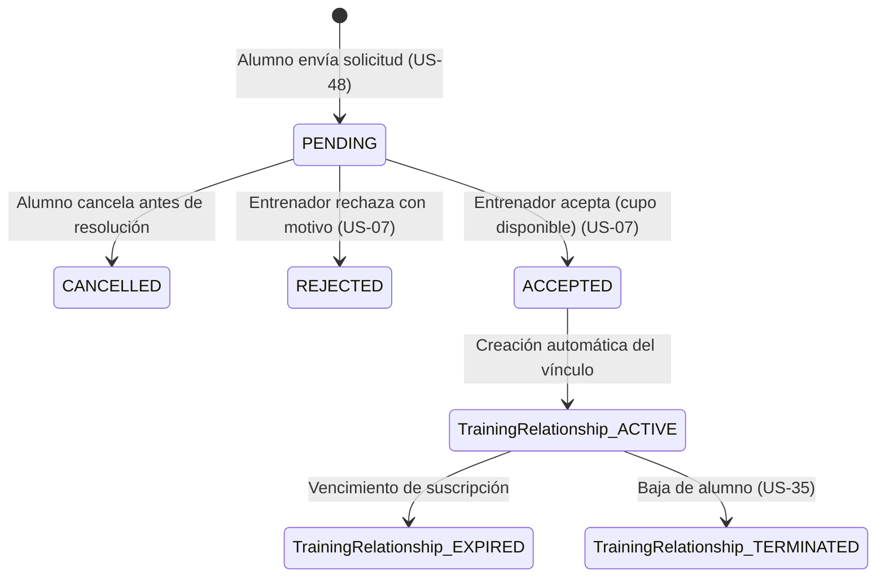

# Data Model: Búsqueda de Entrenadores, Perfiles Públicos y Solicitudes de Alta

**Feature**: `004-discovery-and-matchmaking`
**Date**: 2026-10-15

## Entidades y Atributos

### 1. `TrainingRequest` (US-48, US-06, US-07)
Solicitud enviada por un alumno a un entrenador para contratar un paquete específico.

| Campo | Tipo | Nulo | Por Defecto | Descripción |
|---|---|---|---|---|
| `id` | UUID / String(36) | No | `uuid4()` | Identificador primario. |
| `student_id` | UUID / String(36) | No | - | Clave foránea a `StudentProfile.id`. |
| `trainer_id` | UUID / String(36) | No | - | Clave foránea a `TrainerProfile.id`. |
| `plan_id` | UUID / String(36) | No | - | Clave foránea a `TrainingPlan.id` seleccionado (US-47). |
| `status` | Enum(`PENDING`, `ACCEPTED`, `REJECTED`, `CANCELLED`) | No | `'PENDING'` | Estado actual de la solicitud. |
| `student_message` | Text | Sí | `None` | Mensaje inicial de presentación del alumno. |
| `trainer_response_message`| Text | Sí | `None` | Motivo de rechazo o nota de bienvenida del entrenador. |
| `created_at` | DateTime (UTC) | No | `utcnow()` | Fecha de envío de la solicitud. |
| `resolved_at` | DateTime (UTC) | Sí | `None` | Fecha de resolución (aceptación, rechazo o cancelación). |

### 2. `TrainingRelationship` (Vínculo Activo Alumno-Entrenador, US-49)
Representa la relación contractual y técnica activa entre alumno y entrenador.

| Campo | Tipo | Nulo | Por Defecto | Descripción |
|---|---|---|---|---|
| `id` | UUID / String(36) | No | `uuid4()` | Identificador primario. |
| `student_id` | UUID / String(36) | No | - | Clave foránea a `StudentProfile.id`. |
| `trainer_id` | UUID / String(36) | No | - | Clave foránea a `TrainerProfile.id`. |
| `plan_id` | UUID / String(36) | No | - | Clave foránea a `TrainingPlan.id`. |
| `status` | Enum(`ACTIVE`, `EXPIRED`, `TERMINATED`) | No | `'ACTIVE'` | Estado del vínculo de entrenamiento. |
| `start_date` | Date | No | `current_date()` | Fecha de inicio del entrenamiento. |
| `end_date` | Date | Sí | `None` | Fecha límite según suscripción o pagos. |
| `terminated_at` | DateTime (UTC) | Sí | `None` | Marca temporal exacta de baja/rescisión (US-35). |
| `termination_reason` | Text | Sí | `None` | Causa de finalización de la relación. |

## Máquina de Estados de la Solicitud

