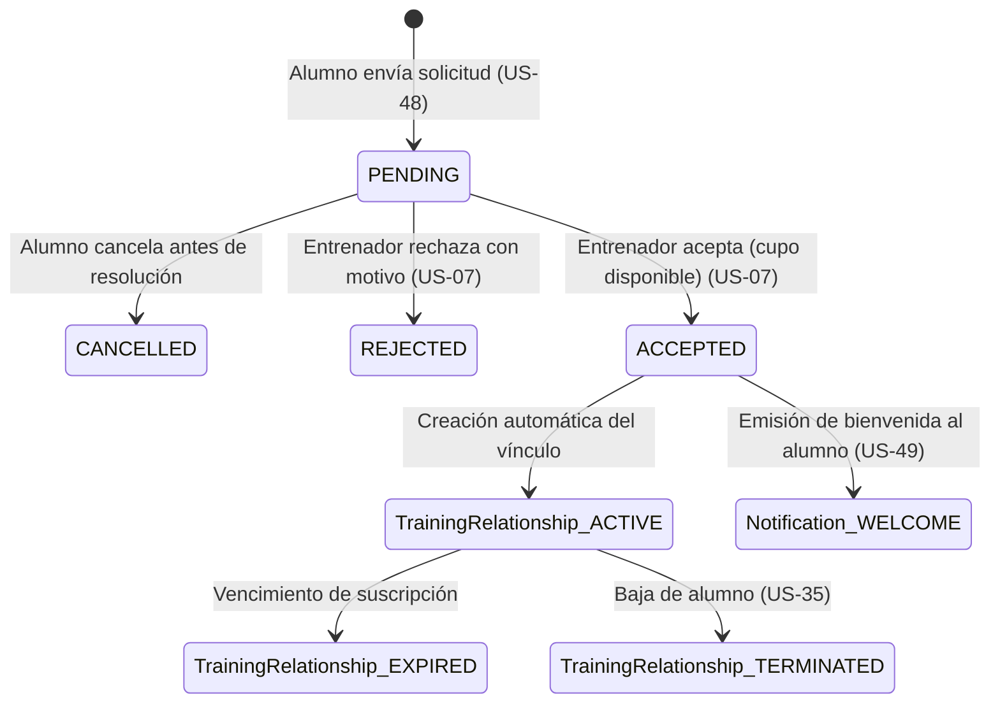

# Data Model: Búsqueda de Entrenadores, Perfiles Públicos y Solicitudes de Alta

**Feature**: `004-discovery-and-matchmaking`
**Date**: 2026-10-15

## Entidades y Atributos

### 1. `TrainingRequest` (US-48, US-06, US-07)
Solicitud enviada por un alumno a un entrenador para contratar un paquete específico.

| Campo | Tipo | Nulo | Por Defecto | Descripción |
|---|---|---|---|---|
| `id` | UUID / String(36) | No | `uuid4()` | Identificador primario. |
| `student_id` | UUID / String(36) | No | - | Clave foránea a `StudentProfile.id`. |
| `trainer_id` | UUID / String(36) | No | - | Clave foránea a `TrainerProfile.id`. |
| `plan_id` | UUID / String(36) | No | - | Clave foránea a `TrainingPlan.id` seleccionado (US-47). Debe ser un paquete activo al enviar la solicitud. |
| `agreed_monthly_price` | Numeric(10, 2) | No | - | Copia de `TrainingPlan.monthly_price` al enviar la solicitud; no se recalcula si el paquete cambia (FR-010). |
| `agreed_currency` | String(3) | No | - | Copia de `TrainingPlan.currency` al enviar la solicitud (FR-010). |
| `status` | Enum(`PENDING`, `ACCEPTED`, `REJECTED`, `CANCELLED`) | No | `'PENDING'` | Estado actual de la solicitud. |
| `student_message` | Text | Sí | `None` | Mensaje inicial de presentación del alumno. |
| `trainer_response_message`| Text | Sí | `None` | Motivo de rechazo o nota de bienvenida del entrenador. |
| `created_at` | DateTime (UTC) | No | `utcnow()` | Fecha de envío de la solicitud. |
| `resolved_at` | DateTime (UTC) | Sí | `None` | Fecha de resolución (aceptación, rechazo o cancelación). |

### 2. `TrainingRelationship` (Vínculo Activo Alumno-Entrenador, US-49)
Representa la relación contractual y técnica activa entre alumno y entrenador.

| Campo | Tipo | Nulo | Por Defecto | Descripción |
|---|---|---|---|---|
| `id` | UUID / String(36) | No | `uuid4()` | Identificador primario. |
| `student_id` | UUID / String(36) | No | - | Clave foránea a `StudentProfile.id`. |
| `trainer_id` | UUID / String(36) | No | - | Clave foránea a `TrainerProfile.id`. |
| `plan_id` | UUID / String(36) | No | - | Clave foránea a `TrainingPlan.id`. |
| `agreed_monthly_price` | Numeric(10, 2) | No | - | Heredado de `TrainingRequest.agreed_monthly_price` al aceptarse; es el arancel del vínculo (FR-010). |
| `agreed_currency` | String(3) | No | - | Heredado de `TrainingRequest.agreed_currency` al aceptarse (FR-010). |
| `status` | Enum(`ACTIVE`, `EXPIRED`, `TERMINATED`) | No | `'ACTIVE'` | Estado del vínculo de entrenamiento. |
| `start_date` | Date | No | `current_date()` | Fecha de inicio del entrenamiento. |
| `end_date` | Date | Sí | `None` | Fecha límite según suscripción o pagos. |
| `welcome_message` | Text | Sí | `None` | Mensaje de bienvenida personalizado del entrenador (US-49). |
| `welcome_message_sent` | Boolean | No | `True` | Flag que confirma el despacho de la notificación de bienvenida (US-49). |
| `initial_routine_id` | UUID / String(36) | Sí | `None` | Clave foránea opcional a la primera rutina asignada al alumno (`Routine.id`, US-49). |
| `terminated_at` | DateTime (UTC) | Sí | `None` | Marca temporal exacta de baja/rescisión (US-35). |
| `termination_reason` | Text | Sí | `None` | Causa de finalización de la relación. |

### 3. `Notification` (Notificaciones In-App, US-49)
Representa una notificación recibida por un usuario en la plataforma.

| Campo | Tipo | Nulo | Por Defecto | Descripción |
|---|---|---|---|---|
| `id` | UUID / String(36) | No | `uuid4()` | Identificador primario. |
| `recipient_id` | UUID / String(36) | No | - | Clave foránea a `User.id` (destinatario). |
| `type` | Enum(`TRAINING_ACCEPTED`, `TRAINING_REJECTED`, `NEW_REQUEST`, `ROUTINE_ASSIGNED`, `GENERAL`) | No | - | Tipo o categoría del evento notificado. |
| `title` | String(150) | No | - | Título descriptivo de la notificación. |
| `message` | Text | No | - | Cuerpo descriptivo o mensaje de bienvenida. |
| `related_entity_type` | String(50) | Sí | `None` | Entidad vinculada (ej: `'TrainingRelationship'`). |
| `related_entity_id` | UUID / String(36) | Sí | `None` | ID de la entidad para navegación directa. |
| `is_read` | Boolean | No | `False` | Indicador de lectura de la notificación. |
| `created_at` | DateTime (UTC) | No | `utcnow()` | Fecha y hora de emisión (UTC). |
| `read_at` | DateTime (UTC) | Sí | `None` | Fecha y hora en la que fue leída. |

## Máquina de Estados de la Solicitud

